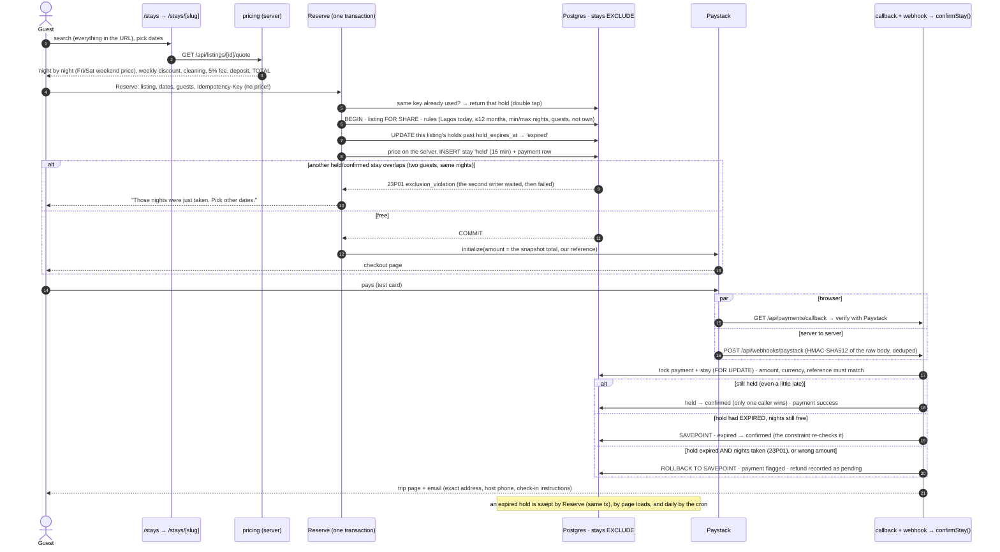
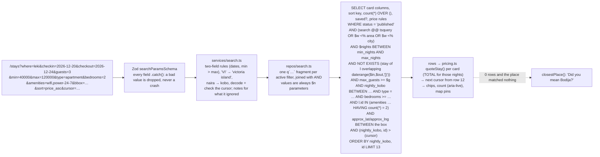

# Staybook

**Day 23 of the 30-day dev challenge: listings, search and bookings.**

Staybook is a short-let platform for Nigeria: serviced apartments in Lekki Phase 1, Victoria Island, Ikoyi and Yaba, Wuse 2, Maitama and Gwarinpa in Abuja, GRA in Port Harcourt and Bodija in Ibadan.

- **Hosts** list places with photos, prices, house rules and the amenities that matter here: 24/7 power (generator, inverter or solar), Wi-Fi, security, borehole water, parking, a pool, PS5, Netflix.
- **Guests** search by area, dates, guests and budget, and see only the places that are free on those nights, priced for exactly that stay. They book and pay with Paystack, and review after they've stayed.
- **An admin** approves every listing before it goes public.

The new ideas today:

1. A search that combines full-text search, fuzzy area matching, filters, a map area and date availability, and is still **one SQL query**.
2. Date-range bookings that **can never overlap**, enforced by a PostgreSQL exclusion constraint.
3. Hosts managing listings, with **photo uploads that never pass through the server**.

Everything else is reused from Days 16–22: auth, the service layer, idempotency, demo mode, kobo money, composite foreign keys and exactly-once Paystack fulfilment.

---

## Contents

1. [Setup (Windows, Git Bash)](#1-setup-windows-git-bash)
2. [Deploying to Vercel](#2-deploying-to-vercel)
3. [Diagrams](#3-diagrams)
4. [How double booking is prevented](#4-how-double-booking-is-prevented)
5. [How search is built and indexed (with EXPLAIN)](#5-how-search-is-built-and-indexed)
6. [How pricing works](#6-how-pricing-works)
7. [Payments, holds and cancellations](#7-payments-holds-and-cancellations)
8. [How photo uploads are secured](#8-how-photo-uploads-are-secured)
9. [The location privacy rule](#9-the-location-privacy-rule)
10. [Ownership checks (both layers)](#10-ownership-checks-both-layers)
11. [Database notes: every table, constraint and ON DELETE](#11-database-notes)
12. [Scheduled work](#12-scheduled-work)
13. [Demo mode and logins](#13-demo-mode-and-logins)
14. [The palette: Concrete and Jacaranda](#14-the-palette-concrete-and-jacaranda)
15. [Accessibility](#15-accessibility)
16. [The check script](#16-the-check-script)
17. [What changed when reusing the Day 17 auth](#17-what-changed-when-reusing-the-day-17-auth)
18. [Things learned along the way](#18-things-learned-along-the-way)
19. [Concepts and where they live](#19-concepts-and-where-they-live)
20. [Out of scope, and worth adding next](#20-out-of-scope-and-worth-adding-next)

---

## 1. Setup (Windows, Git Bash)

You need Node 22.18 or newer (the scripts run TypeScript directly with Node's type stripping).

```bash
npm install
cp .env.example .env.local     # then fill it in (below)
npm run db:migrate             # applies db/migrations/001-011
npm run db:seed                # safe to run twice
npm run check:bookings         # 13 PASS lines
npm run dev                    # http://localhost:3023
```

**Neon.** Create a new project (or a branch) for Day 23 and copy the pooled connection string (the host has `-pooler`) into `DATABASE_URL`. You can optionally add the direct string as `DATABASE_URL_UNPOOLED`; only `db:migrate` uses it. The migrations enable `citext`, `pg_trgm` and `btree_gist`, all of which Neon allows.

**Vercel Blob.** In the Vercel dashboard, go to Storage → Create → Blob, then open the store's `.env.local` tab and copy `BLOB_READ_WRITE_TOKEN`. The seed doesn't need it: seed photos are real room photographs in `public/seed`, released as CC0 and credited in `public/seed/CREDITS.md`. Uploading new photos does.

**Paystack (test mode).**

1. Dashboard → Settings → API Keys & Webhooks. Copy the test secret key (`sk_test_…`) into `PAYSTACK_SECRET_KEY`.
2. Set the webhook URL to `<APP_URL>/api/webhooks/paystack`. Locally, Paystack can't reach you, but the browser callback confirms payments on its own.
3. To pay, use the test card `4084 0840 8408 4081`, any future expiry, CVV `408`, PIN `0000`, OTP `123456`.

**Email.** Leave `RESEND_API_KEY` empty and every email (confirmations with the arrival details, cancellations, review reminders, listing decisions) is printed to the terminal. Emails to `example.com` addresses (all seeded and demo accounts) are always printed, never sent.

**Secrets.** Generate `CRON_SECRET` and `ICAL_SIGNING_SECRET` with:

```bash
node -e "console.log(require('crypto').randomBytes(32).toString('base64url'))"
```

The seed passwords are `SEED_USER_PASSWORD` and `SEED_ADMIN_PASSWORD`, at least 8 characters each.

| Script | What it does |
|---|---|
| `npm run db:migrate` | Applies new files in `db/migrations`, each in a transaction, recorded in `schema_migrations` with a checksum. |
| `npm run db:seed` | 10 people, 20 listings (18 published, 2 pending), bookings, blocks, reviews. Idempotent. |
| `npm run check:bookings` | Runs the booking rules against the real database ([§16](#16-the-check-script)). |
| `npm run db:explain` | EXPLAIN ANALYZE of the real search query ([§5](#5-how-search-is-built-and-indexed)). |
| `npm run check:contrast` | Every colour pairing against WCAG, in both modes ([§14](#14-the-palette-concrete-and-jacaranda)). |
| `npx tsc --noEmit` / `npm run build` | Type check / production build. |

## 2. Deploying to Vercel

1. Push the repo and import it in Vercel. The defaults are right: Next.js, `npm run build`.
2. Add every variable from `.env.example` in Project → Settings → Environment Variables:

   | Variable | Value |
   |---|---|
   | `DATABASE_URL` | Neon **pooled** connection string |
   | `APP_URL` | `https://your-project.vercel.app` (every email link is built from this, never from the Host header) |
   | `RESEND_API_KEY`, `EMAIL_FROM` | Resend key and a verified sender, or leave empty to log emails |
   | `PAYSTACK_SECRET_KEY` | `sk_test_…` |
   | `BLOB_READ_WRITE_TOKEN` | Added automatically when you connect the Blob store to the project |
   | `CRON_SECRET` | 32+ random characters. Vercel Cron sends it as `Authorization: Bearer …` |
   | `ICAL_SIGNING_SECRET` | 32+ random characters (signs the calendar feed URLs) |
   | `SEED_USER_PASSWORD`, `SEED_ADMIN_PASSWORD` | Only needed where you run the seed |
   | `DEMO_MODE` | `true` (default) shows the demo buttons; `false` hides them and turns the routes off |

3. **The region.** `vercel.json` pins the functions to `fra1` (Frankfurt), next to the Neon database in `eu-central-1`. Every statement inside a transaction is a network round trip, so the function and the database should be in the same place.
4. **The cron job.** `vercel.json` schedules `GET /api/cron/daily` at `0 5 * * *`, which is 06:00 in Lagos (Vercel crons are in UTC). The route answers 401 to anyone without the bearer secret.
5. In Paystack, point the webhook at `https://your-project.vercel.app/api/webhooks/paystack`.
6. Run `npm run db:migrate` and `npm run db:seed` from your machine with the production `DATABASE_URL` (or a Neon branch).

## 3. Diagrams

### 3.1 The database schema

```mermaid
erDiagram
  users ||--o{ sessions : "CASCADE"
  users ||--o{ listings : "host_id · RESTRICT"
  users ||--o{ stays : "guest_id · RESTRICT (NULL for blocks)"
  listings ||--o{ listing_photos : "(host_id, listing_id) · CASCADE"
  listings ||--o{ listing_amenities : "CASCADE"
  amenities ||--o{ listing_amenities : "RESTRICT"
  listings ||--o{ price_rules : "(host_id, listing_id) · CASCADE"
  listings ||--o{ stays : "(host_id, listing_id) · RESTRICT"
  stays ||--o| reviews : "(stay_id, listing_id, guest_id) · RESTRICT"
  stays ||--o{ payments : "RESTRICT"
  payments ||--o{ refunds : "RESTRICT"
  stays ||--o{ refunds : "RESTRICT"
  users ||--o{ saved_listings : "CASCADE"
  listings ||--o{ saved_listings : "CASCADE"
  users ||--o{ audit_events : "actor · SET NULL"

  users { uuid id PK; citext email UK; text role "guest|host|admin"; text phone "private"; bool is_demo; timestamptz suspended_at }
  listings { uuid id PK; uuid host_id FK; text slug UK; text title; text property_type; smallint bedrooms; smallint max_guests; text area; text address_line "PRIVATE"; numeric lat "PRIVATE"; numeric lng "PRIVATE"; bigint nightly_kobo; bigint weekend_kobo; bigint cleaning_fee_kobo; bigint caution_deposit_kobo; smallint weekly_discount_percent; text status; tsvector search "GENERATED + GIN"; numeric rating_avg "cached"; int version; UK host_id_id "composite FK target" }
  listing_photos { uuid id PK; uuid listing_id; uuid host_id; text blob_url; text alt_text "required"; smallint position "0-11, UNIQUE DEFERRABLE" }
  amenities { text code PK; text label; text grp }
  listing_amenities { uuid listing_id PK; text amenity_code PK }
  price_rules { uuid id PK; uuid listing_id; uuid host_id; daterange nights "EXCLUDE overlap"; bigint nightly_kobo }
  stays { uuid id PK; text kind "booking|host_block"; uuid listing_id; uuid host_id; uuid guest_id; daterange nights "[)"; text status; timestamptz hold_expires_at; jsonb price_lines; bigint total_kobo; text idempotency_key; EXCLUDE no_overlap "gist(listing_id =, nights &&) WHERE held/confirmed" }
  reviews { uuid id PK; uuid stay_id UK; smallint overall; smallint power_supply; text comment; text host_reply }
  payments { uuid id PK; uuid stay_id; text reference UK; bigint amount_kobo; text status; UK one_success "partial: per stay" }
  webhook_events { bigint id PK; text dedupe_key UK; jsonb payload }
  refunds { uuid id PK; uuid stay_id; bigint amount_kobo; text status "pending"; text kind }
  saved_listings { uuid user_id PK; uuid listing_id PK }
  audit_events { bigint id PK; uuid actor_id; text action; uuid listing_id }
```

The Day 17 tables are unchanged: `sessions`, `email_tokens`, `auth_events` and `rate_limits`. Alongside them sit `email_log` ("send each email once") and `cron_runs`.

### 3.2 The booking flow



### 3.3 One search request becomes one SQL query



## 4. How double booking is prevented

Everything that occupies a listing's nights is a row in **one table**, `stays` (`db/migrations/008_stays.sql`). That covers a guest's booking (`kind = 'booking'`) and a host's block (`kind = 'host_block'`). The nights are a `daterange`, and one constraint guards them all:

```sql
CONSTRAINT stays_no_overlap EXCLUDE USING gist (listing_id WITH =, nights WITH &&)
  WHERE (status IN ('held', 'confirmed'))
```

It means: no two rows for the same listing (`=`) whose nights overlap (`&&`) may both be held or confirmed.

- **Why a constraint and not "check, then insert"?** Two guests press Reserve for 20–24 December at the same moment. Both SELECTs run before either INSERT, both see the nights free, and both insert. Any check-then-write in application code has that gap. The exclusion constraint is checked inside the database as each row is written, through its GiST index. PostgreSQL makes the second writer wait for the first to commit, then refuses it with `23P01`. The service turns that into "Those nights were just taken. Pick other dates." The check script fires 10 Reserves at once and gets exactly 1 hold.
- **Why `[)`?** A stay from the 10th to the 12th is the nights of the 10th and 11th, written `'[2026-12-10, 2026-12-12)'`: the check-in date is included, the check-out date excluded. `[10,12) && [12,15)` is false, because they share no night. So one guest can check out on the morning of the 12th and the next check in that afternoon. A CHECK makes every range finite, non-empty and exactly `[)`.
- **Why are host blocks in the same table?** An exclusion constraint (like a UNIQUE constraint) only compares rows of its own table. With blocks in a separate table, a booking could land on a blocked night and nothing in the database would notice. In one table, a block can't overlap a booking, a booking can't overlap a block, and two blocks can't overlap either.
- **`btree_gist`.** A GiST index understands ranges and `&&`, but has no `=` for a plain `uuid`. The `btree_gist` extension adds those operator classes, so one index can say "same listing AND overlapping nights".
- **Expired holds and the race this closes.** A constraint's condition must be immutable, so it can't say "held and not yet expired" (`now()` changes). A hold 30 seconds past its 15 minutes therefore still blocks the nights until something marks it `expired`.
  - **What Reserve does:** inside the same transaction as its INSERT, it first runs `UPDATE stays SET status = 'expired' WHERE listing_id = $1 AND status = 'held' AND hold_expires_at <= now()`.
  - **Why the same transaction matters:** with a separate sweep, a second guest's insert would be refused by a hold that should already have gone, any time it ran between the sweep and the insert. The UPDATE also takes row locks, so racing Reserves take turns.
  - **Reads don't depend on the sweep:** they use `status = 'confirmed' OR (status = 'held' AND hold_expires_at > now())`, so search and the date picker treat a stale hold as free even before it's swept.
  - **The daily cron** sweeps every listing, for the rows nobody looks at.

## 5. How search is built and indexed

`/stays` reads everything from the URL, so a search can be bookmarked, shared and reopened exactly. An example:

`/stays?where=lekki&checkin=2026-12-20&checkout=2026-12-24&guests=3&min=40000&max=120000&type=apartment&bedrooms=2&amenities=wifi,power-24-7&sort=price_asc`

- **Validation.** `lib/schemas.ts` (`searchParamsSchema`) gives every field `.catch()`, so `guests=lots` means "any", `sort=cheapest` means "recommended", and an invalid `bbox` means no map filter. Rules involving two fields, or Lagos "today", are applied in `lib/services/search.ts`. Whatever was ignored is shown above the results ("We ignored the dates: check-in can't be in the past"), not silently fixed. The filter form's checkboxes arrive as `?amenity=a&amenity=b`, and `proxy.ts` redirects them to the canonical `?amenities=a,b`.
- **One query, built safely.** `lib/repos/search.ts` turns each active filter into a parameterised `q` fragment (Day 20's builder) and joins them with `AND`. User input is always a `$n` value and never part of the SQL text. The parts that can't be parameters (the sort column and direction) come from a fixed table in the code (`SORT_SPECS`), never from the URL.
- **"where".**
  - Full-text search runs on a generated `tsvector`. Title and area are weighted A, the city B, the description C.
  - Place names use the `'simple'` dictionary, so "Ikoyi" isn't stemmed; prose uses `'english'`, so "apartments" matches "apartment".
  - **pg_trgm word similarity** (`$w <% area`) catches typos and fragments: "Leki" and "Victoria Iland" both match. Trigram similarity compares the three-letter pieces two strings share.
  - `<%` asks whether the typed word is close to some part of a long name. Plain `similarity()` would compare "leki" with all of "Lekki Phase 1" and fail.
  - A few abbreviations can't be matched by letters at all, so they're expanded first: `VI` → Victoria Island, `PH` → Port Harcourt, `ph1` → phase 1.
  - If the place matches nothing, `closestPlace()` offers "Did you mean Bodija?". If the place matched but the dates or filters ruled everything out, the empty state instead offers to remove one filter at a time.
- **Dates.** `NOT EXISTS (… s.nights && daterange($in, $out, '[)'))` stops at the first clash. The listing must also allow that many nights, and fit the guests.
- **Amenities "has ALL of".** `l.id IN (SELECT listing_id FROM listing_amenities WHERE amenity_code = ANY($codes) GROUP BY listing_id HAVING count(*) = $n)`. The primary key on `(listing_id, amenity_code)` stops duplicate rows from inflating the count.
- **The map.** With "Search as I move the map" on, every pan or zoom writes `?bbox=south,west,north,east` into the URL, and the same single query filters on it. It filters on the approximate coordinates, never the exact ones ([§9](#9-the-location-privacy-rule)).
- **Totals on every card.** With dates chosen, the query also returns the listing's special prices for those nights. Each card's total then comes from the same `quoteStay()` that Reserve uses, with no extra query.
- **Keyset (cursor) pagination.**
  - Each sort is a key plus the id as a tie-breaker: `ORDER BY nightly_kobo, id`.
  - The next page asks for rows after the last one: `WHERE (nightly_kobo, id) > ($k, $id)`.
  - `OFFSET 500` makes PostgreSQL produce and throw away 500 rows, so it gets slower with every page. It's also inconsistent: when a listing is published or paused while you browse, everything shifts by one, so a row appears twice or is skipped.
  - A cursor seeks straight to the right spot in the index, and "after this row" stays put.
  - The cursor is opaque (base64url JSON) and carries a fingerprint of the filters, so a cursor from another search restarts at page 1 with a note.
  - The total count (`count(*) OVER ()`) is only computed on page 1: a window count has to visit every match.

### EXPLAIN ANALYZE (on the seeded database)

Produced by `npm run db:explain`, which runs the same `searchSql()` the page uses. With about 20 listings, PostgreSQL rightly prefers small sequential scans for some parts, so each search is shown **as planned** and again with `enable_seqscan = off`. The second run shows which index each part uses once the tables are big enough. The inlined `approx_lat()`/`approx_lng()` expressions are shortened to their function names for width; everything else is verbatim.

**Search 2: place + dates + 2 guests** (with seq scans off). The availability `NOT EXISTS` becomes an anti-join served by the exclusion constraint's own GiST index (`stays_no_overlap`). Special prices for those nights come from `price_rules_no_overlap`, and the walk in recommended order comes from `listings_pub_recommended_idx`.

```text
=== 2. Place + dates (2026-10-29 to 2026-11-01) + 2 guests  [enable_seqscan = off: the indexes it can use] ===
Limit (actual time=0.168..0.170 rows=1.00 loops=1)
  Buffers: shared hit=34
  ->  WindowAgg (actual time=0.167..0.169 rows=1.00 loops=1)
        Window: w1 AS ()
        Storage: Memory  Maximum Storage: 17kB
        Buffers: shared hit=34
        ->  Nested Loop Anti Join (actual time=0.057..0.117 rows=1.00 loops=1)
              Join Filter: (s.listing_id = l.id)
              Rows Removed by Join Filter: 8
              Buffers: shared hit=33
              ->  Nested Loop Left Join (actual time=0.028..0.072 rows=3.00 loops=1)
                    Buffers: shared hit=23
                    ->  Index Scan using listings_pub_recommended_idx on listings l (actual time=0.019..0.057 rows=3.00 loops=1)
                          Filter: (('3'::smallint >= min_nights) AND ('3'::smallint <= max_nights) AND (max_guests >= '2'::smallint) AND ((search @@ '''lekki'' | ''lekki'''::tsquery) OR ('lekki'::text <% area) OR ('lekki'::text <% city)))
                          Rows Removed by Filter: 15
                          Index Searches: 1
                          Buffers: shared hit=17
                    ->  Index Scan using listing_photos_position_key on listing_photos cover (actual time=0.003..0.004 rows=1.00 loops=3)
                          Index Cond: ((listing_id = l.id) AND ("position" = 0))
                          Index Searches: 3
                          Buffers: shared hit=6
              ->  Bitmap Heap Scan on stays s (actual time=0.011..0.013 rows=3.33 loops=3)
                    Recheck Cond: ((nights && '[2026-10-29,2026-11-01)'::daterange) AND (status = ANY ('{held,confirmed}'::text[])))
                    Filter: ((status = 'confirmed'::text) OR ((status = 'held'::text) AND (hold_expires_at > now())))
                    Heap Blocks: exact=5
                    Buffers: shared hit=10
                    ->  Bitmap Index Scan on stays_no_overlap (actual time=0.005..0.005 rows=7.00 loops=3)
                          Index Cond: (nights && '[2026-10-29,2026-11-01)'::daterange)
                          Index Searches: 3
                          Buffers: shared hit=3
        SubPlan 1
          ->  Aggregate (actual time=0.006..0.007 rows=1.00 loops=1)
                Buffers: shared hit=1
                ->  Index Scan using price_rules_no_overlap on price_rules r (actual time=0.004..0.004 rows=0.00 loops=1)
                      Index Cond: ((listing_id = l.id) AND (nights && '[2026-10-29,2026-11-01)'::daterange))
                      Index Searches: 1
                      Buffers: shared hit=1
Planning:
  Buffers: shared hit=3
Planning Time: 0.529 ms
Execution Time: 0.286 ms
```

**Search 3: dates + a Lagos map box + amenities, sorted by price** (as planned). The map box is answered by the expression index `listings_pub_approx_geo_idx`. With seq scans off, the amenities subquery uses `listing_amenities_code_idx` and the sort walks `listings_pub_price_idx`.

```text
=== 3. Dates + Lagos map box + amenities (wifi, power-24-7), sorted by price  [as planned] ===
Limit (actual time=0.183..0.203 rows=5.00 loops=1)
  Buffers: shared hit=18
  ->  Result (actual time=0.182..0.202 rows=5.00 loops=1)
        Buffers: shared hit=18
        ->  Sort (actual time=0.145..0.146 rows=5.00 loops=1)
              Sort Key: l.nightly_kobo, l.id
              Sort Method: quicksort  Memory: 27kB
              Buffers: shared hit=13
              ->  WindowAgg (actual time=0.137..0.140 rows=5.00 loops=1)
                    Window: w1 AS ()
                    Storage: Memory  Maximum Storage: 18kB
                    Buffers: shared hit=13
                    ->  Hash Right Anti Join (actual time=0.127..0.131 rows=5.00 loops=1)
                          Hash Cond: (s.listing_id = l.id)
                          Buffers: shared hit=13
                          ->  Seq Scan on stays s (actual time=0.005..0.015 rows=7.00 loops=1)
                                Filter: ((nights && '[2026-10-29,2026-11-01)'::daterange) AND ((status = 'confirmed'::text) OR ((status = 'held'::text) AND (hold_expires_at > now()))))
                                Rows Removed by Filter: 46
                                Buffers: shared hit=4
                          ->  Hash (actual time=0.108..0.109 rows=8.00 loops=1)
                                Buckets: 1024  Batches: 1  Memory Usage: 11kB
                                Buffers: shared hit=9
                                ->  Nested Loop (actual time=0.080..0.107 rows=8.00 loops=1)
                                      Join Filter: (l.id = la.listing_id)
                                      Rows Removed by Join Filter: 77
                                      Buffers: shared hit=9
                                      ->  Hash Right Join (actual time=0.049..0.061 rows=9.00 loops=1)
                                            Hash Cond: (cover.listing_id = l.id)
                                            Buffers: shared hit=7
                                            ->  Seq Scan on listing_photos cover (actual time=0.009..0.014 rows=20.00 loops=1)
                                                  Filter: ("position" = 0)
                                                  Rows Removed by Filter: 60
                                                  Buffers: shared hit=2
                                            ->  Hash (actual time=0.038..0.038 rows=9.00 loops=1)
                                                  Buckets: 1024  Batches: 1  Memory Usage: 10kB
                                                  Buffers: shared hit=5
                                                  ->  Index Scan using listings_pub_approx_geo_idx on listings l (actual time=0.026..0.034 rows=9.00 loops=1)
                                                        Index Cond: ((approx_lat(lat, id) >= 6.4) AND (approx_lat(lat, id) <= 6.55) AND (approx_lng(lng, id) >= 3.35) AND (approx_lng(lng, id) <= 3.5))
                                                        Filter: (('3'::smallint >= min_nights) AND ('3'::smallint <= max_nights))
                                                        Index Searches: 1
                                                        Buffers: shared hit=5
                                      ->  HashAggregate (actual time=0.003..0.004 rows=9.44 loops=9)
                                            Group Key: la.listing_id
                                            Filter: (count(*) = '2'::bigint)
                                            Batches: 1  Memory Usage: 32kB
                                            Rows Removed by Filter: 2
                                            Buffers: shared hit=2
                                            ->  Seq Scan on listing_amenities la (actual time=0.006..0.019 rows=36.00 loops=1)
                                                  Filter: (amenity_code = ANY ('{wifi,power-24-7}'::text[]))
                                                  Rows Removed by Filter: 138
                                                  Buffers: shared hit=2
        SubPlan 1
          ->  Aggregate (actual time=0.002..0.002 rows=1.00 loops=5)
                Buffers: shared hit=5
                ->  Index Scan using price_rules_no_overlap on price_rules r (actual time=0.001..0.002 rows=0.00 loops=5)
                      Index Cond: ((listing_id = l.id) AND (nights && '[2026-10-29,2026-11-01)'::daterange))
                      Index Searches: 5
                      Buffers: shared hit=5
Planning Time: 0.704 ms
Execution Time: 0.297 ms
```

**Search 4: page 2 of "price, low to high".** The keyset cursor becomes an `Index Cond` on a row comparison: an index seek, not a skip.

```text
=== 4. Page 2 of "price low to high" (keyset cursor, no window count)  [as planned] ===
Limit (actual time=0.091..0.126 rows=13.00 loops=1)
  Buffers: shared hit=14
  ->  Result (actual time=0.090..0.124 rows=13.00 loops=1)
        Buffers: shared hit=14
        ->  Sort (actual time=0.064..0.066 rows=13.00 loops=1)
              Sort Key: l.nightly_kobo, l.id
              Sort Method: quicksort  Memory: 31kB
              Buffers: shared hit=14
              ->  Hash Right Join (actual time=0.041..0.054 rows=13.00 loops=1)
                    Hash Cond: (cover.listing_id = l.id)
                    Buffers: shared hit=14
                    ->  Seq Scan on listing_photos cover (actual time=0.008..0.014 rows=20.00 loops=1)
                          Filter: ("position" = 0)
                          Rows Removed by Filter: 60
                          Buffers: shared hit=2
                    ->  Hash (actual time=0.029..0.029 rows=13.00 loops=1)
                          Buckets: 1024  Batches: 1  Memory Usage: 11kB
                          Buffers: shared hit=12
                          ->  Index Scan using listings_pub_price_idx on listings l (actual time=0.013..0.024 rows=13.00 loops=1)
                                Index Cond: (ROW(nightly_kobo, id) > ROW('5000000'::bigint, '00000000-0000-0000-0000-000000000000'::uuid))
                                Index Searches: 1
                                Buffers: shared hit=12
Planning Time: 0.254 ms
Execution Time: 0.169 ms
```

**The "where" indexes.** At this size the planner walks the ORDER BY index and filters the three-way OR (search 1). These probes show each test can be answered by its GIN index once the table needs it:

```text
=== 5a. Full-text: search @@ "lekki" (GIN on the tsvector)  [enable_seqscan = off] ===
Bitmap Heap Scan on listings (actual time=0.039..0.040 rows=4.00 loops=1)
  Recheck Cond: (search @@ '''lekki'''::tsquery)
  Heap Blocks: exact=3
  Buffers: shared hit=8
  ->  Bitmap Index Scan on listings_search_idx (actual time=0.028..0.028 rows=7.00 loops=1)
        Index Cond: (search @@ '''lekki'''::tsquery)
        Index Searches: 1
        Buffers: shared hit=5
Planning:
  Buffers: shared hit=1
Planning Time: 0.106 ms
Execution Time: 0.072 ms

=== 5b. Fuzzy: "leki" <% area (GIN trigram on area)  [enable_seqscan = off] ===
Bitmap Heap Scan on listings (actual time=0.034..0.040 rows=4.00 loops=1)
  Filter: ('leki'::text <% area)
  Heap Blocks: exact=3
  Buffers: shared hit=10
  ->  Bitmap Index Scan on listings_area_trgm_idx (actual time=0.020..0.020 rows=7.00 loops=1)
        Index Cond: (area %> 'leki'::text)
        Index Searches: 1
        Buffers: shared hit=7
Planning:
  Buffers: shared hit=4
Planning Time: 0.120 ms
Execution Time: 0.116 ms

=== 5c. Fuzzy: "abuj" <% city (GIN trigram on city)  [enable_seqscan = off] ===
Bitmap Heap Scan on listings (actual time=0.049..0.054 rows=6.00 loops=1)
  Filter: ('abuj'::text <% city)
  Heap Blocks: exact=3
  Buffers: shared hit=10
  ->  Bitmap Index Scan on listings_city_trgm_idx (actual time=0.033..0.033 rows=11.00 loops=1)
        Index Cond: (city %> 'abuj'::text)
        Index Searches: 1
        Buffers: shared hit=7
Planning:
  Buffers: shared hit=1
Planning Time: 0.095 ms
Execution Time: 0.082 ms
```

| Part of the query | Index |
|---|---|
| `status = 'published'` | every listing index is partial on it (drafts aren't in them at all) |
| full-text `search @@ …` | `listings_search_idx` (GIN on the generated tsvector) |
| fuzzy `$w <% area / city` | `listings_area_trgm_idx`, `listings_city_trgm_idx` (GIN, `gin_trgm_ops`) |
| availability `NOT EXISTS … &&` | `stays_no_overlap` (the exclusion constraint's GiST index) |
| amenities ALL | `listing_amenities_code_idx (amenity_code, listing_id)` |
| map box | `listings_pub_approx_geo_idx` (expression index on `approx_lat`, `approx_lng`) |
| sorts and cursors | `listings_pub_{recommended,price,rating,newest}_idx`, each ending in `id` |
| cover photo join | `listing_photos_position_key (listing_id, position)` |
| special prices | `price_rules_no_overlap` (GiST) |

## 6. How pricing works

`lib/pricing.ts` (`quoteStay`) is the **only** place a price is worked out. It is pure (no database, no clock), so the check script tests it against a total worked out by hand.

1. **Each night is priced on its own**, as a Lagos calendar date. A host's special price for that date (`price_rules`, e.g. "Festive season") wins; otherwise Friday and Saturday nights use `weekend_kobo` (when set); every other night uses `nightly_kobo`.
2. **Stays of 7 nights or more** get `weekly_discount_percent` off the nightly subtotal (not off the cleaning fee or the deposit).
3. **The cleaning fee** is added once.
4. **A 5% guest service fee** is charged on (subtotal − discount + cleaning).
5. **The refundable caution deposit** is added last. No fee is charged on it, since it's the guest's own money, held.

Every percentage is rounded half up to whole kobo with integer arithmetic only (`percentOf` in `lib/money.ts`). Every amount is integer kobo in a `bigint` column and is formatted with `Intl.NumberFormat("en-NG", { style: "currency", currency: "NGN" })`.

**Why the browser never sends a price.** Anything a browser sends can be edited. Reserve takes only the listing, the dates, the guests and an idempotency key, then prices the stay again on the server from the database's own numbers. It does this inside the transaction, with the listing row locked `FOR SHARE`, so a host can't change the price halfway. The result is **snapshotted** on the stay: the night-by-night lines as JSON, plus each total in kobo. A CHECK makes the total equal its parts to the kobo. Paystack is asked for exactly that amount, and a payment for any other amount is refused. The snapshot also means a host raising prices tomorrow doesn't change what this guest agreed to.

**The hand-worked example** in the check script:

| | |
|---|---|
| Listing | ₦50,000 a night, ₦65,000 on Fri/Sat, ₦15,000 cleaning, ₦50,000 deposit, 10% weekly discount |
| Stay | Mon 1 Mar 2027 → Tue 9 Mar 2027: 8 nights, including 2 weekend nights |
| Nights | 6 × 50,000 + 2 × 65,000 = **₦430,000.00** |
| Discount | 10% of 430,000 = **−₦43,000.00** |
| Cleaning | **₦15,000.00** |
| Service fee | 5% of (430,000 − 43,000 + 15,000) = **₦20,100.00** |
| Deposit | **₦50,000.00** |
| **Total** | **₦472,100.00** = 47,210,000 kobo ✔ |

**The rules every booking must pass** (`lib/booking-rules.ts`, applied by search, the date picker and, finally, Reserve):

- check-in is not in the past (Lagos "today");
- check-in is at most 12 months ahead;
- the number of nights is between `min_nights` and `max_nights`;
- guests ≤ `max_guests`;
- a host can't book their own listing. This is also a CHECK: `guest_id <> host_id`.

## 7. Payments, holds and cancellations

- **The hold.** Reserve creates a `held` stay that expires 15 minutes later, then starts a Paystack transaction outside the database transaction, so no locks are held while waiting on the internet. If Paystack can't be reached, the hold is cancelled at once rather than blocking the nights for 15 minutes.
- **Double tap.** The browser sends an `Idempotency-Key`, made once per page view. A second tap finds the first hold (`UNIQUE (guest_id, idempotency_key)`) and is sent to the same checkout page. After a failed attempt the key changes, so a deliberate retry is a new attempt.
- **Exactly-once confirmation** (`lib/services/payments.ts`, Day 22's design). The browser callback and the webhook both call `confirmStay()`. Three guards make sure a payment is confirmed once:
  - `SELECT … FOR UPDATE` on the payment and the stay, so a racing callback and webhook take turns;
  - a conditional `UPDATE … WHERE status = 'held'`, so only one caller can flip the status;
  - a partial unique index allowing one successful payment per stay.
- **Never trust the redirect.** The callback asks Paystack's verify endpoint what really happened. The webhook checks the HMAC-SHA512 of the raw body and is deduplicated by `webhook_events`.
- **Payments that can't be honoured** are recorded, flagged, and turned into a pending refund. Two cases:
  - **Wrong amount:** the hold is also released.
  - **Paid after the hold expired:** the stay is moved back to confirmed inside a SAVEPOINT. The exclusion constraint re-checks it like a new row. If someone else has since booked those nights, that step fails with `23P01`, is rolled back to the savepoint, and a refund is recorded instead.
- **Cancellation.** The guest sees a refund preview based on the policy snapshotted on the stay (`lib/refunds.ts`). Cancelling frees the nights at once. Refunds are recorded as `pending`, never sent.

  | Policy | Stay amount refunded | Caution deposit |
  |---|---|---|
  | Flexible | 100% up to 24 hours before check-in | always refunded in full |
  | Moderate | 100% up to 5 days before check-in | always refunded in full |
  | Strict | 50% up to 7 days before, then nothing | always refunded in full |

  "Before check-in" means the listing's check-in time on the check-in date, in Lagos.
- **Emails.** Guest and host are emailed on confirmation (the guest's copy has the exact address, the host's phone and the check-in instructions) and on cancellation. Each email is "claimed" in `email_log` first, so it's sent once.

## 8. How photo uploads are secured

**Why images never go in the database.** A 3 MB photo in a `bytea` column makes every backup, replica and `SELECT *` 3 MB heavier, and the database would be serving image bytes to every visitor. A CDN (Vercel Blob) serves them faster, from close to the visitor, and cheaper. The database keeps the URL, the pathname (needed to delete the file), the size, the alt text and the position.

**Why client uploads.** A Vercel function's request body is limited to about 4.5 MB. A 5 MB photo sent through a Server Action would be refused, and a slow upload from a phone would keep a function running (and billed) the whole time. With client uploads, the browser asks our route for a one-time token, then sends the file straight to Blob. The bytes never touch our function.

**Location data is removed first.** Phone photos carry EXIF metadata, often including the GPS position where the picture was taken: for a photo of a flat, its exact location. Publishing that would undo the location privacy rule ([§9](#9-the-location-privacy-rule)). So before anything is uploaded, the browser draws each photo onto a canvas and exports a clean copy (`cleanCopy` in `components/host/photo-manager.tsx`):

- only the pixels survive: no GPS, no camera serial, no date;
- the photo is turned upright (EXIF orientation applied);
- it is shrunk to at most 2560 px on its longest side.

Originals up to 25 MB are accepted; the clean copy must be 5 MB or less, and that copy is what gets uploaded.

**The checks** (`app/api/photos/upload/route.ts`, then `lib/services/photos.ts`):

1. The token request must be same-origin and signed in, and is rate-limited per user.
2. The listing in the request must be **this host's**. Someone else's listing gets the same 404 as one that doesn't exist.
3. There must be room left: fewer than 12 photos.
4. The pathname must be `listings/<that listing id>/<32 random characters>.<jpg|png|webp>`: random, so it can't be guessed. Blob also adds its own random suffix (`addRandomSuffix`).
5. The token itself only allows `image/jpeg`, `image/png` or `image/webp`, at most 5 MB, for 10 minutes. Blob enforces this whatever the browser does.
6. When the browser reports the upload, `recordPhoto` checks the URL is our Blob store and under that listing before saving the row, with its **required alt text**. The database CHECKs say the same: alt text of 5–200 characters, and a URL from our store.
7. `position` is 0–11 and unique per listing, so the 13th photo is refused by the database (`23514`) even if the route had a bug.

**Ordering and deletion.**

- **Reorder** works by drag and drop, or with the "Earlier / Later / Make cover" buttons. The new order is saved in one statement: `UPDATE … FROM unnest($ids) WITH ORDINALITY`. The unique `(listing_id, position)` is `DEFERRABLE`, so it's checked once at the end of the statement rather than per row, while two photos briefly share a position.
- **Deleting a photo** removes the row and renumbers the rest in one transaction. Only after the commit is the blob deleted (`del()`), so a failed commit can never leave a row pointing at a deleted file.
- **Progress and errors** are shown per file and announced in an `aria-live` region.

## 9. The location privacy rule

Before a booking is confirmed, a listing shows only its area and a circle about a kilometre and a half across. The exact address, the exact pin, the host's phone number and the check-in instructions appear only to the guest of a confirmed (or completed) booking.

**Why on the server, not by hiding things in the UI.** Anything sent to the browser can be read. "Hidden" props are in the HTML and in the React payload, a map library keeps the exact marker position in memory, and the developer tools show every network response. So the exact values must never leave the server for a public page:

- **The public queries never name `address_line`, `lat`, `lng` or `checkin_instructions`.** They select `approx_lat(lat, id)` and `approx_lng(lng, id)`, SQL functions in `db/migrations/011`. These round to 2 decimal places (about 1.1 km) and add a small fixed offset derived from the listing id, so twelve flats in one estate don't stack on one point. The precision is limited by the rounding, which can't be undone.
- **The map-box filter uses the approximate values too.** Otherwise anyone could find a flat's real position by shrinking the box until the listing drops out: about twenty searches would pin it to a few metres. An expression index keeps that filter indexed.
- **The private fields are released by the SQL itself:** `CASE WHEN s.status IN ('confirmed', 'completed') THEN l.address_line END` in `lib/repos/stays.ts`. A held, cancelled or expired stay gets NULL, however the page is written.
- **The check script** asserts the exact address and the exact coordinates are absent from the public listing response.

## 10. Ownership checks (both layers)

**Layer 1: the services and their SQL.** Every function takes the acting user (or `null` for a visitor) first.

| Who | Can see or change | How it's enforced |
|---|---|---|
| A visitor | published listings, search, quotes | public repo queries filter `status = 'published'` and select no private columns |
| A guest | only their own trips | every trip query is `WHERE s.guest_id = $actor` (`getGuestStay`, `listGuestStays`) |
| A host | only their own listings, photos, calendars, price rules, and bookings on them | every query is `WHERE host_id = $actor` (`getHostListing`, `listPhotos`, `hostCalendar`, `listHostStays`, `setHostReply`) |
| The demo host | everything a host sees, but read-only, with guests masked | `assertCanWrite()` refuses every write; guest names become initials |
| A suspended host | their listings, read-only | `requireHost({ write: true })` refuses; their listings were paused in the same statement |
| An admin | the review queue, every booking, host suspension | `requireAdmin()` (role, plus a verified email) |

**Someone else's record by id returns 404, not 403.** "Forbidden" would confirm the record exists and whose it is. `proxy.ts` also answers `/trips/<id>` and `/host/listings/<id>` with a real 404 status when the row isn't yours: under Cache Components the page has started streaming with 200 before its `notFound()` can run (the Day 19 lesson).

**Layer 2: the database.** Composite foreign keys (the Day 21 pattern) mean a row can only belong to a listing of the same host:

```sql
FOREIGN KEY (host_id, listing_id) REFERENCES listings (host_id, id)   -- listing_photos, price_rules, stays
FOREIGN KEY (stay_id, listing_id, guest_id) REFERENCES stays (id, listing_id, guest_id)   -- reviews
```

Even if a service forgot its check and tried to add Tunde's photo, block or special price to Amaka's flat, the database would find no matching `(host, listing)` pair and refuse it (`23503`). Further guards:

- `CHECK (guest_id <> host_id)`: no booking your own listing.
- `UNIQUE (stay_id)` on reviews: one review per stay.
- A trigger allows a review only once the stay is completed.

## 11. Database notes

The migrations live in `db/migrations`; each file explains every column, constraint and index where it's declared. The highlights:

**Extensions.**

- `citext`: case-insensitive emails (Day 17).
- `pg_trgm`: trigram similarity and its GIN operator class, for typo-tolerant place search.
- `btree_gist`: GiST operator classes for plain `=`, so one exclusion constraint can say "same listing AND overlapping nights".

**Amenities are a table, not a `text[]`:**

- one spelling only: the foreign key accepts only known codes, so no "wifi" vs "Wi-Fi" vs "WiFi";
- labels and groups live in one place;
- adding "Starlink" is an INSERT;
- "has ALL of" is an indexed GROUP BY / HAVING (see [§5](#5-how-search-is-built-and-indexed)).

**Every ON DELETE, chosen on purpose:**

| Foreign key | ON DELETE | Why |
|---|---|---|
| `listings.host_id → users` | RESTRICT | a host with listings can't be deleted; an admin suspends instead |
| `stays (host_id, listing_id) → listings` | RESTRICT | **listings with bookings are paused or archived, never hard-deleted** |
| `stays.guest_id → users` | RESTRICT | a guest's history stays (the demo cleanup deletes demo stays explicitly, after a guard) |
| `listing_photos`, `price_rules` → listings | CASCADE | meaningless without the listing (only drafts can be deleted, and their blobs are deleted first) |
| `listing_amenities.listing_id` | CASCADE | as above |
| `listing_amenities.amenity_code` | RESTRICT | retire an amenity on purpose, not by accident |
| `reviews (stay…) → stays` | RESTRICT | reviews are history |
| `payments → stays`, `refunds → payments/stays` | RESTRICT | money records outlive everything |
| `saved_listings → users / listings` | CASCADE | a wishlist entry means nothing once either is gone |
| `audit_events.actor_id`, `.listing_id`, `.target_user_id` | SET NULL | the record of what happened outlives whoever did it |
| `sessions`, `email_tokens → users` | CASCADE | Day 17 |

**`updated_at`** is kept current by the `set_updated_at()` trigger on every table that has it.

**Should review averages be cached?** The truth is an aggregate over `reviews`: `averagesFor()` on the listing page shows exact figures. But "Top rated" and "Recommended" are keyset sorts, and a sort needs an indexed column, not an aggregate over every review on every search. So `listings.rating_avg`, `rating_count` and `recommended_score` are a cache, kept honest in two ways:

1. It is refreshed in the same transaction as each review insert, so it can't drift from the reviews it summarises.
2. The daily cron recomputes it for every listing, so even a manual SQL fix (or a demo guest's reviews being deleted) heals within a day.

`recommended_score` is a Bayesian average: the rating pulled towards 4.0 by 3 imaginary reviews, so one 5-star review doesn't outrank forty 4.8s.

**Optimistic concurrency.** Each step of the listing form sends the `version` it was editing. `UPDATE … WHERE version = $v` changes nothing if another tab saved first, and the host is asked to reload.

## 12. Scheduled work

`GET /api/cron/daily` is protected by `CRON_SECRET` (a constant-time comparison) and scheduled in `vercel.json`. Every step is idempotent, and each run is recorded in `cron_runs` and shown on `/admin`.

1. Expire holds past `hold_expires_at`, and mark their payments abandoned.
2. Mark confirmed bookings `completed` the day after check-out (Lagos date).
3. Send review reminders, once each: the `UPDATE … SET review_reminder_sent_at` claims the row, and `email_log` stops a second send.
4. Delete demo guests older than 24 hours, with everything they made.
5. Recompute the cached ratings.
6. Purge old rate-limit rows.

**The same work runs lazily** when relevant pages load (Day 20):

- a listing page sweeps that listing's holds;
- `/trips` and `/host` complete finished stays and sweep holds;
- Reserve sweeps inside its own transaction;
- starting a demo tidies away old demo guests (after the response).

Running the cron twice in a row: the first run sent one reminder; the second changed nothing.

## 13. Demo mode and logins

- **"Try as a guest"** creates a private demo guest. They get an upcoming confirmed trip and a completed stay waiting for a review, both on the demo host's listings, so no real host's calendar fills up. They can search, book with the Paystack test card, cancel and review. The account and everything it made are deleted after 24 hours.
- **"Look around as a host"** signs in to one shared demo host with listings, a calendar and bookings. It is read-only: every host write is refused in the services (`assertCanWrite`), and other visitors' names are masked to initials.
- **How the demo buttons work:** no passwords (demo accounts have none, enforced by a CHECK). The buttons are POST-only Server Actions, never links, so crawlers and WhatsApp previews can't create accounts. They're rate-limited to 10 an hour per IP, and a banner says it's a demo.
- **Demo emails are `demo+<id>@example.com`.** On Day 20 Paystack refused `.invalid` addresses. `example.com` is also reserved (it will never have real inboxes) but has a valid shape, and Paystack accepts it: checked against the test API while building today. Nothing is ever really sent to `example.com`.

**Seeded logins** (passwords from `.env.local`):

| Email | Password | Who |
|---|---|---|
| `guest@example.com` | `SEED_USER_PASSWORD` | a guest with an upcoming trip and a finished stay to review |
| `amaka@example.com`, `tunde@example.com`, `zainab@example.com` | `SEED_USER_PASSWORD` | hosts |
| `admin@example.com` | `SEED_ADMIN_PASSWORD` | the admin; two listings are waiting for review |

## 14. The palette: Concrete and Jacaranda

Abuja's purple jacaranda trees over grey city concrete, used in a 60/25/10/5 ratio so the page stays calm and the few accents mean something:

- **60% Concrete: the surfaces.** Page `#F3F2EF`, cards `#FCFBF9`, sunken areas (the filter sheet, photo placeholders, calendar header) `#E8E6E1`, hairlines `#DAD8D2`, form field borders `#8A8891`.
- **25% Graphite: the words.** Headings and text `#26252D`, secondary text `#5B5A63`, and the footer band.
- **10% Jacaranda: what you can act on.** `#6A4FA3` (hover `#573E8E`) with white text on primary buttons, links, the brand, focus rings, the wishlist heart, and the chosen check-in and check-out. The nights in between are the tint `#ECE6F7`. Never used for large backgrounds.
- **5% Sand: a few warm marks.** `#C9A66B` only as a fill behind graphite text: price tags, map pins, the Total pill, "Pending review". As text it is the deep sand `#7F5E24`: stars, "Guest favourite".
- **Functional colours,** for small messages only, always with an icon or a word: error `#A3283C`, success `#2E6A4B`.
- **Dark mode ("Abuja at night").** Page `#17161B`, cards `#211F26`, sunken `#2B2932`, text `#EDEBE6`, violet `#B9A4EC` with `#17161B` text on buttons, sand `#DDBD82`.

Every colour is defined once, as a token in the Tailwind v4 `@theme` block in `app/globals.css`. There are palette tokens (`concrete-*`, `graphite-*`, `jacaranda-*`, `sand-*`) and semantic tokens (`bg-card`, `text-ink`, `bg-primary`, …), each a `light-dark()` pair. `--color-*: initial` removes Tailwind's default palette, so an off-palette `text-orange-500` doesn't exist. The theme switches with no flash: an inline `<head>` script sets `data-theme` before first paint (`lib/theme.ts`).

**Contrast (`npm run check:contrast`, all 52 pairings pass):**

| Pairing | Light | Dark |
|---|---|---|
| text on page / card | 13.54 / 14.66 | 15.10 / 13.68 |
| secondary text on page / card / sunken | 6.08 / 6.58 / 5.45 | 7.51 / 6.80 / 5.98 |
| links (jacaranda) on page / card | 5.75 / 6.23 | 8.21 / 7.44 |
| button text on jacaranda / hover | 6.44 / 8.45 | 8.21 / 10.42 |
| text on the selected-range tint | 12.44 | 12.01 |
| graphite on sand (price tags) | 6.61 | 10.00 |
| deep sand on page / card (stars) | 5.32 / 5.75 | 10.00 / 9.06 |
| error / success on card | 6.94 / 6.19 | 6.82 / 8.49 |
| footer text | 13.54 | 16.14 |
| **field borders on card / page** (3:1 needed) | 3.38 / 3.12 | 3.13 / 3.45 |
| focus ring on card | 6.23 | 7.44 |

One pairing failed while I built this: field borders on the sunken filter sheet came out at 2.80:1. The sheet stays sunken, and the fields now sit on a card inside it.

**Typography.** Fraunces (a soft old-style serif with an optical-size axis, like a guesthouse's hand-lettered name board) is used for headings, which never carry a price. Fira Sans is the body font: very readable on a small screen, with the ₦ sign and tabular figures, so prices line up. The mark is a hand-drawn key on a split ring, with a jacaranda blossom for a fob (`components/brand/mark.tsx`).

## 15. Accessibility

- **The date picker** (`components/booking/date-picker.tsx`) is a grid with one tab stop:
  - ← → move a day, ↑ ↓ a week, Page Up/Down a month, Home/End the week, Enter or Space chooses.
  - Every day has a full name ("Friday, 20 December 2026, booked, not available").
  - Unavailable days stay focusable (`aria-disabled`) and say why.
  - The chosen range and its number of nights are announced.
- **Calendar states never rely on colour.** Check-in and check-out are violet with an "In"/"Out" label, booked nights are muted and struck through, and host-blocked nights are hatched. A legend explains each.
- **Forms** have labels, inline errors linked with `aria-describedby`, and an error summary that takes focus on submit. They show pending states and keep their values after an error (Day 17–21 components).
- **Live regions** announce the search result count, the live quote, upload progress, the hold countdown and booking status.
- **The gallery** works with the keyboard and with swipe.
- **Every photo has alt text:** the upload can't happen without it.
- **Visible focus everywhere,** and `prefers-reduced-motion` is respected.
- **The map is never the only way.** The list beside it has every result, the pin's coordinates can be typed, and the approximate circle has a text description.
- **On a phone** (down to 360px):
  - the filters open as a full-screen sheet that traps focus and closes on Escape;
  - the booking panel becomes a sticky bottom bar with the total and Reserve;
  - the map sits behind "Show the map", so the list comes first.
- **Loading and error states.** Skeletons for loading, empty states that suggest what to change, and real not-found pages. If the database can't be reached, a friendly error explains that nothing half-saved was saved.

## 16. The check script

`npm run check:bookings` runs the real service functions against the database. It creates throwaway hosts, guests and a listing in "Checkville", and deletes them afterwards. Output from the seeded database:

```text
PASS  An overlapping booking is rejected (23P01 → "nights_taken")  (conflict:nights_taken)
PASS  Back-to-back stays are allowed (check-out day = next check-in day)  (ok)
PASS  A host block stops a booking  (conflict:nights_taken)
PASS  An expired hold no longer blocks (swept in the same transaction)  (ok, old hold expired)
PASS  10 simultaneous reserves for the same nights give exactly 1 hold  (1 held, 9 refused)
PASS  Pricing with weekend nights and a 7+ night discount matches the hand-worked total  (total 47210000 kobo)
PASS  Search with dates excludes a booked listing (and shows it when free)  (busy dates: 0 result(s), free dates: 1)
PASS  A guest opening another guest’s booking gets not found  (other: not_found:not_found, own: ok)
PASS  A host editing another host’s listing gets not found  (not_found:not_found)
PASS  The exact address is absent from a public listing response  (checked the address, and the exact lat/lng)
PASS  Callback + webhook together confirm exactly once  (already_confirmed + confirmed)
PASS  A payment after the hold expired and the nights were taken is refused and flagged for a refund  (refund_pending)
PASS  A payment with the wrong amount is refused (and the hold released)  (refund_pending, stay cancelled)
13 passed, 0 failed
```

## 17. What changed when reusing the Day 17 auth

**Copied from the Day 21 copy** (`../30days-21-personal-finance`), following Day 17's "How to reuse this auth" section, so the Day 18–21 fixes came along:

- `lib/db/*` (with `withTransaction`) and `lib/auth/*`;
- `users.ts`, `rows.ts`, `validation.ts`, `safe-redirect.ts`, `next-errors.ts`, `user-agent.ts`, `action-helpers.ts`, `pagination.ts`, `theme.ts`, `url.ts`;
- the `(auth)` pages, `components/forms/*`, `/logout`, `/start`;
- migrations `001`–`005` (unchanged) and `scripts/migrate.mts`.

**Day 18–22 fixes brought over:**

- confirmation dialogs that trap Tab and return focus;
- empty live regions that take no space;
- `authorizeRequest()`;
- 23001 and 23503 both read as "still referenced";
- explicit `IS NOT NULL` in CHECKs;
- `isDbUnreachable()`;
- typed `ServiceError`s;
- demo accounts without passwords;
- Day 22's Paystack client, webhook dedupe and exactly-once confirm, rewritten onto this `lib/db` layer.

**Changed for this app:**

1. **Roles are `guest`, `host` and `admin`** (migration `006`). Sign-up always creates a guest. `/host/start` turns a guest into a host (phone number required), and the role change and its audit event happen in one statement.
2. **New user columns:** `phone` (private, `+234…`) and `suspended_at`. Suspension also pauses the host's listings, in the same statement.
3. **Demo emails are `demo+<id>@example.com`,** not Day 20's `.invalid`, which Paystack rejected. Any `example.com` address is printed instead of sent.
4. **"Delete my account" is gone again** (as on Days 18–20): stays must keep their guest and host.
5. **Rate limits** gained `reserve` and `upload` (and `demo` from Day 20).
6. **The email frame** uses the Concrete and Jacaranda colours, and gained `emailTable()` for price breakdowns.
7. **`proxy.ts`** protects `/trips`, `/saved`, `/host` and `/admin`. It gives honest 404s for `/trips/<id>` and `/host/listings/<id>`, and canonicalises `?amenity=` checkboxes.
8. **The actor is `User | null`** (a visitor is `null`), with a separate `SystemActor` for Paystack and the cron.
9. **Renames:** cookie `staybook_session` (`__Host-staybook_session` in production), header `x-staybook-path`, theme key `staybook-theme`, migration lock key, Pwned Passwords user agent.

## 18. Things learned along the way

- **PostgreSQL 17 builds indexes with a "safe" `search_path`** (`pg_catalog, pg_temp`). The expression index on `approx_lat()` failed with "function approx_coord does not exist", because `approx_lat`'s body called `approx_coord` unqualified. The fix was to schema-qualify it (`public.approx_coord`). Migration 011 had rolled back cleanly, so it was safe to fix in place.
- **`$$` in a JavaScript `replace()` replacement string means a single `$`.** A script that edited SQL turned `$$ … $$` function bodies into `$ … $`. In replacement strings, `$` is special.
- **Filtering a map box on exact coordinates leaks them,** even when the map only ever shows a circle: shrinking the box until a result disappears is a binary search for the real position. The filter has to use the same rounded values the map shows.
- **"Did you mean?" needs to know why there were no results.** The first version offered "Lekki Phase 1" to someone who had searched Lekki for booked-up dates. Now it's offered only when the place itself matched nothing.
- **Node's ESM resolver needs `next/headers.js`.** Next's subpath files have no `exports` map, so the scripts' resolve hook adds the extension.

## 19. Concepts and where they live

| Concept | File | One-line explanation |
|---|---|---|
| No double booking | `db/migrations/008_stays.sql` | `EXCLUDE USING gist (listing_id WITH =, nights WITH &&) WHERE (status IN ('held','confirmed'))`. |
| Bookings and blocks in one table | `db/migrations/008_stays.sql` | An exclusion constraint only compares rows of its own table. |
| Half-open nights `[)` | `db/migrations/008_stays.sql`, `lib/time.ts` | Check-out day excluded, so back-to-back stays share no night. |
| Hold + same-transaction sweep | `lib/services/bookings.ts` (`createHold`) | Expire stale holds, re-price, insert; 23P01 → "Those nights were just taken." |
| Idempotent Reserve | `lib/services/bookings.ts`, `components/booking/booking-panel.tsx` | `UNIQUE (guest_id, idempotency_key)` returns the first hold to a double tap. |
| Server-side pricing | `lib/pricing.ts` | Per-night Lagos weekdays, weekly discount, half-up 5% fee, deposit; snapshotted on the stay. |
| Exactly-once confirmation | `lib/services/payments.ts` | Row locks, a conditional flip, one-success index, a SAVEPOINT for late payments. |
| Refund preview | `lib/refunds.ts` | The policy snapshotted on the stay, measured to Lagos check-in time. |
| One search, one query | `lib/repos/search.ts` | Parameterised fragments joined with AND; sort chosen from code, never the URL. |
| URL state with safe fallbacks | `lib/schemas.ts`, `lib/search-url.ts` | Zod `.catch()` per field; chips with remove links; canonical URLs. |
| Fuzzy place search | `lib/repos/search.ts`, `db/migrations/007_listings.sql` | Full-text tsvector plus pg_trgm `<%`, with GIN indexes. |
| Keyset pagination | `lib/repos/search.ts`, `lib/pagination.ts` | `(key, id) > cursor` per sort; opaque cursor with a filter fingerprint. |
| Has ALL amenities | `lib/repos/search.ts` | `GROUP BY listing_id HAVING count(*) = n`. |
| Location privacy | `db/migrations/011_location_privacy.sql`, `lib/repos/stays.ts` | Approximate coordinates in SQL; private fields only via `CASE WHEN confirmed`. |
| Client uploads to Blob | `app/api/photos/upload/route.ts`, `lib/services/photos.ts` | A one-time token with type/size/path limits; the bytes never reach our function. |
| One-statement reorder | `lib/repos/photos.ts` | `UPDATE … FROM unnest() WITH ORDINALITY`, with a DEFERRABLE unique position. |
| Composite foreign keys | `db/migrations/007`, `008`, `010` | `(host_id, listing_id) → listings (host_id, id)`: rows can't cross hosts. |
| 404 not 403 | `lib/services/*`, `proxy.ts` | Missing and not-yours look the same; the proxy sets an honest status. |
| Host calendar and unblock | `lib/services/calendar.ts`, `lib/repos/stays.ts` | Blocks are stays; unblocking uses multirange subtraction. |
| Occupancy in SQL | `lib/repos/host.ts` | `generate_series` nights × `@>` bookings, blocked nights left out. |
| Signed iCal feed | `lib/services/calendar.ts`, `app/api/listings/[id]/calendar.ics/route.ts` | An HMAC token in the URL is the only credential; rotate with `ical_version`. |
| Cached ratings | `lib/repos/listings.ts` (`refreshRating`) | Refreshed with each review and by the cron; Bayesian "recommended". |
| Reviews only after a stay | `db/migrations/010_reviews_saved_audit_cron.sql` | `UNIQUE (stay_id)`, a composite FK and a "completed stay" trigger. |
| Daily + lazy jobs | `lib/services/cron.ts`, `app/api/cron/daily/route.ts` | Idempotent steps; the same sweeps run when pages load. |
| Demo mode | `lib/services/demo.ts`, `lib/services/actor.ts` | Private demo guests with trips; a shared read-only host; `example.com` emails. |
| Accessible date picker | `components/booking/date-picker.tsx` | A roving-tabindex grid, keyboard moves, reasons for disabled days, live summary. |
| Maps | `components/map/*` | Leaflet + OSM tiles loaded in the browser; approximate pins; search as I move. |
| Design tokens | `app/globals.css`, `scripts/check-contrast.mjs` | Concrete & Jacaranda as `light-dark()` tokens, every pairing checked. |
| Migrations | `scripts/migrate.mts` | Numbered SQL files, each in a transaction, recorded in `schema_migrations`. |
| Proof | `scripts/check-bookings.mts` | The booking rules against the real database. |

## 20. Out of scope, and worth adding next

Out of scope today:

- host payouts and split payments (Day 25);
- guest–host messaging (Day 24);
- sending real refunds (they're recorded as pending);
- request-to-book with host approval;
- importing other platforms' calendars (the iCal feed only exports);
- ID verification;
- dynamic pricing;
- a mobile app;
- automated tests beyond the check script.

Worth adding next:

- **PostGIS** (`geography` plus a GiST index) once there are tens of thousands of listings. "Within 3 km of me" and true distance sorting would then be indexed.
- **Search ranking by relevance** (`ts_rank` plus trigram similarity) for the "recommended" sort when a place is typed, with a keyset key that includes it.
- **Server-side image checks:** blurhash placeholders, and decoding each upload on the server to confirm it really is an image. Metadata is already stripped in the browser, but a hand-made upload with a valid token could still carry it.
- **A real refunds desk** for admins: process pending refunds through Paystack's refund API.
- **Per-night availability caching** (a materialised calendar) if the `NOT EXISTS` ever becomes the slow part.
- **Host response-time and cancellation-rate** badges, computed in SQL like occupancy.
